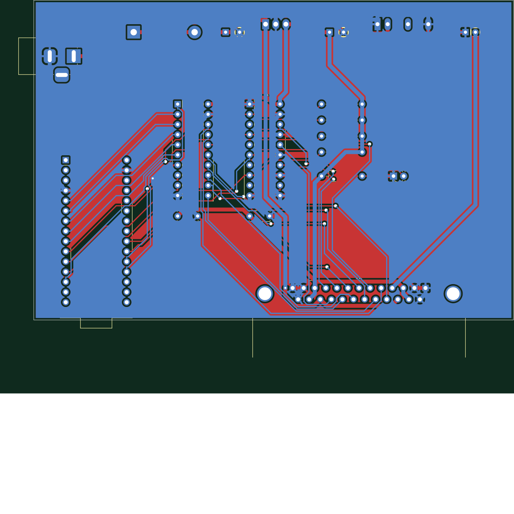

# MOD-EMUP over USB

Bring a 1990s universal device programmer back to life on a modern computer.

The **MOD-EMUP** (sold by JDR Microdevices; the same machine as the Hi-Lo
**ALL-03**, the Tribal TUP-400 and the Expro-60) programs parts that modern
programmers won't touch: bipolar PROMs (82S123, 82S129, 74S287, ...), old
PALs, GALs, PEELs and EPROMs. Arcade and vintage-computer people still need
those. But the box only talks to an 8-bit ISA card and DOS software.

This project replaces the ISA card with a small USB adapter and the DOS
software with a desktop app.

| | |
|---|---|
| **Status** | Designed, simulated and unit-tested. **Not yet tried on a real box.** |
| **Why it's posted** | The original author ran out of time. Everything needed to finish it is here; the missing piece is someone with a box, a meter and an afternoon. |

## What's here

| Folder | What | State |
|---|---|---|
| [`hardware/`](hardware/) | USB adapter PCB (KiCad 8): Arduino Nano, 74HCT245 / 74HCT244 bus buffers, DB25 to the box, and **one 12 V supply** for everything: +12 V passed through, +5 V 2 A from a RECOM R-78B switching module, -12 V from an isolated TRACO TMR 1-1211. All through-hole. Gerbers and BOM in `hardware/fab/`. Or build it on a breadboard with an old PC power supply: [`docs/BREADBOARD.md`](docs/BREADBOARD.md). | Routed, DRC clean. Not fabricated. |
| [`firmware/emup_usb/`](firmware/emup_usb/) | Arduino sketch: runs batches of register writes, reads and timed delays sent over USB serial (1 Mbaud), so programming pulses are timed on the adapter, not across USB. | Compiles in principle; untested. |
| [`app/`](app/) | **EMUP Studio**, a Tauri app (Rust + HTML) for macOS, Windows and Linux: chip search, a drawing of where the chip goes in the socket, drag-and-drop .bin / .hex / .jed, hex view, checksums, Read / Blank / Program / Verify. | Runs. 2716 read/program and 2732 read are implemented at register level against a model of the box; other chips use a placeholder. |
| [`dosbox-x/`](dosbox-x/) | A DOSBox-X patch that logs every port access the original DOS programs make, to learn each chip family's algorithm (voltages, pins, timings) without disassembling them. | Works; findings in its README. |
| [`docs/`](docs/) | [Register map and cable pinout](docs/NOTES.md), notes. | |
| [`tools/kicad/`](tools/kicad/) | The scripts that generate the KiCad schematic and routed PCB from `hardware/emup_adapter.py`. | Works. |



## How the box works

The ISA card is just a buffered bus extender: an 8-bit data bus and three
strobes go down a DB25 cable. Everything else is in the box. Software
writes a register number to the card's **ID port**, then reads or writes
that register through the **data port**:

| Register | Does |
|---|---|
| E0-E4 | TTL I/O for socket pins 1-40 (open collector: write 1 before reading or applying a supply) |
| E5 / E6 / E7 | VOP (0.1 V steps) / VHH (0.06 V) / VCC (0.04 V) DACs |
| E8-EC, F0-F4 | switch VOP / VHH onto socket pins |
| ED-EE | switch VCC onto a fixed set of pins |
| EF | ground selection (pin 20 or pins 11 / 30), clocks |
| F7 | bit 3: GOOD lamp |

Full map and the DB25 pinout: [docs/NOTES.md](docs/NOTES.md). Chips sit at
the bottom of the 40-pin socket; chip pin *k* lands on socket pin
*k* + 20 - pins/2, so a 2716's ground lands on socket pin 20 and its VCC on
pin 32, both of which the box can switch.

## Building the adapter

1. Order the board from `hardware/fab/emup_adapter_gerbers.zip` (any 2-layer
   fab) and the parts in `hardware/fab/bom.csv`.
2. **Before plugging into a box:** check the DB25 pinout in
   [docs/NOTES.md](docs/NOTES.md) against your box with a meter. It comes from
   Tom Trebisky's notes on his card; boxes and cables may differ.
3. Power the board alone from a 12 V, 2 A supply (2.1 mm, centre positive)
   and check +5 V, +12 V and -12 V on the DB25 pins.
4. Flash `firmware/emup_usb/emup_usb.ino` to the Nano (Arduino IDE).
5. Connect the box, run the app, pick the adapter's serial port.

The box's real current draw is unknown. The +5 V module gives 2 A and the
-12 V module about 80 mA; measure the box and change the modules if needed.

## Building the app

```sh
cd app/src-tauri
cargo install tauri-cli --version "^2"
cargo tauri dev        # run
cargo tauri build      # make an installable app
cargo test             # the box model: read and program a virtual 2716
```

Needs Rust ([rustup.rs](https://rustup.rs)). Windows also needs WebView2,
which Windows 10 and 11 include.

## What's left to do (good first issues)

* **Try it on a real box.** Measure current draw, confirm the pinout, read a
  known 2716 and compare it with a dump made elsewhere.
* **The identification check.** Every DOS program first checks the box: it
  writes 00, 01, 00, 02 and then pulses to register E7 and reads the low
  nibble of register **F8**, which the ALL-03 documentation doesn't mention.
  The app doesn't need it, but it shows there's logic in the box we don't
  fully understand. See [dosbox-x/README.md](dosbox-x/README.md).
* **More chip algorithms** in `app/src-tauri/src/emup.rs`: 2732 / 27xx
  programming, bipolar PROMs (fuse blowing: VOP pulses on the outputs),
  PAL/GAL programming from JEDEC fuse maps. Record the DOS programs with the
  DOSBox-X patch to see exactly what they do.
* **Release builds** of EMUP Studio for macOS / Windows / Linux (GitHub
  Actions can build all three).

## Credits and sources

* Tom Trebisky's pages on the MOD-EMUP and ALL-03 (cable, card, protocol):
  http://cholla.mmto.org/proms/emup/
* The ALL-03 register description (`all03info.txt`, by the manufacturer,
  with a note by Fabio Sturman) and the ALL-03 manual, findable in vintage
  programmer archives.

The original DOS software, sample images and third-party documents are not
included; find them through the links above.

## Licence

Code (app, firmware, tools, patch): MIT, see [LICENSE](LICENSE); the DOSBox-X
patch is GPL-2.0 like DOSBox-X. Hardware design: CERN-OHL-P-2.0.
